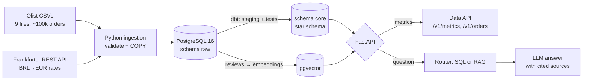

# E-commerce Analytics Assistant

> An end-to-end data platform that turns raw e-commerce data into a trustworthy analytical model, then lets people ask business questions in plain language. Answers come from SQL (numbers) or RAG over customer reviews (reasons), with sources cited.

**Status: work in progress.** The ingestion layer is finished and tested. Modeling, the data API and the AI assistant are being built in the open; see the [roadmap](#roadmap).

---

## Why this project

Most portfolio projects stop at "load a CSV and draw a chart". This one is built around the problems that make real data engineering hard:

- **Repeatable, verifiable loads**: running a pipeline twice must not duplicate data, and every load must prove it loaded what it expected.
- **Messy, realistic data**: the dataset has real quality issues (listed [below](#real-data-problems-this-project-tackles)) that a naive pipeline silently gets wrong.
- **Two kinds of questions**: "what was monthly revenue?" needs exact SQL, while "why are customers unhappy with delivery?" needs retrieval over text. The assistant routes between both and cites its evidence.

## Architecture



Solid parts are built today (ingestion → `raw`); the rest is on the roadmap.

## Tech stack

| Area | Technology |
|---|---|
| Languages | Python 3.12, SQL |
| Database | PostgreSQL 16 + pgvector, run in Docker |
| Ingestion | pandas, psycopg (`COPY`), `requests` with retry/backoff, run log (`etl_log`) |
| Transformation | dbt (staging + core models, data tests) *(planned)* |
| AI | multilingual embeddings, RAG, LLM API, read-only text-to-SQL *(planned)* |
| API | FastAPI, Pydantic, OpenAPI docs *(planned)* |
| Quality & delivery | pytest, GitHub Actions CI *(planned)*, Git/GitHub |

## What works today

### Batch ingestion of the Olist dataset
- Loads 9 CSV files into the `raw` schema with PostgreSQL `COPY`.
- **Repeatable**: a second run does not duplicate rows.
- **Verified**: row counts are compared against the source file after each load.
- **Logged**: every run is recorded in `raw.etl_log` (run id, source, rows expected vs loaded, status, error, timestamps).
- Handles a real-world quirk: a BOM in the category-translation file.

### REST API ingestion (Frankfurter exchange rates)
- Pulls daily BRL→EUR rates for the full order period, 2016-09-01 to 2018-11-12 (563 business days), from a public REST API.
- **Resilient**: timeouts, retry with exponential backoff on `429`/`5xx`, requests split into bounded date windows.
- **Raw first**: the unmodified JSON response is stored in `raw.fx_rates_raw` before any transformation, so loads can be audited and replayed.
- **Idempotent**: upsert on `(rate_date, base, quote)`; re-running it over the full period still yields exactly 563 rows.
- Unit-tested with pytest (date windowing, response flattening).

## Real data problems this project tackles

These issues are in the source data. Each one is handled in dbt and guarded by an automated test; the figures below come from the actual runs.

| Problem | Why it matters | How it was handled |
|---|---|---|
| 789 `review_id`s repeated across 1,603 rows | Looks like duplicates; naive dedup would drop real data | Checked the data first: every repeat sits on a **different `order_id`** with identical content, and there are no exact duplicates. So nothing is deduplicated: `fact_reviews` uses the grain `(review_id, order_id)` with a `unique` test on that pair (99,224 rows). The staging `unique` test on `review_id` alone is kept as a `warn` to document the quirk. |
| 8 orders marked `delivered` with no delivery date | Breaks delivery-time metrics | Flagged with `has_delivery_date_issue` in `fact_orders`. For them `delivery_days` and `is_late` are `NULL`, so they fall out of delivery KPIs instead of skewing them. |
| 2 product categories without translation | Missing labels in reports | `dim_products.product_category` falls back to the Portuguese name (`pc_gamer`, 3 products; `portateis_cozinha_e_preparadores_de_alimentos`, 10 products) and sets `is_translation_missing`. A `not_null` test guards the column. |
| 610 products without a category | Silent gaps in category analysis | Mapped to an explicit `'unknown'` category with `is_category_missing = true`, never `NULL`. |
| Joining `order_items` with `order_payments` | **Duplicates revenue** (fan-out): the naive join yields 117,601 rows and R$ 14,209,115.34 in item price vs. the true R$ 13,591,643.70 (+4.5%) | Separate facts at their own grain: `fact_order_items` (order + item, 112,650 rows) and `fact_payments` (order + payment sequence, 103,886 rows). A singular test proves item price totals in the fact equal staging exactly. |
| FX rates exist only on business days | Weekend and holiday orders would have no rate | `dim_fx_daily` has one row per calendar day with an as-of rate (last ECB rate on or before that day): 239 of 800 days are filled (`is_filled`), the longest gap is 4 days. A test asserts every order item has an EUR rate. |
| Payments don't match items + freight | Payment totals would overstate revenue | Payments total R$ 16,008,872.12 vs. R$ 15,843,553.24 for items + freight (+R$ 165,318.88). Of that, R$ 162,591.95 comes from 775 orders that were paid but have no items (603 `unavailable`, 164 `canceled`, 5 `created`, 2 `invoiced`, 1 `shipped`). They are listed in `recon_payments_without_items`. Orders that have both items and payments differ by only R$ 2,870.39 in total (303 of 98,665 orders). No fact rows are deleted. |

**Revenue definition:** revenue = sum of `price` in `fact_order_items` for orders whose status is not `canceled` or `unavailable` (`where is_revenue`). Freight is excluded. This gives R$ 13,494,400.74 (≈ € 3,424,922.94 at the purchase-day rate).

## Roadmap

- [x] Dockerized PostgreSQL 16 + pgvector with `raw`, `staging`, `core` schemas
- [x] Repeatable CSV ingestion with row-count validation and run log
- [x] REST API ingestion (Frankfurter) with retry and idempotent load
- [x] dbt: staging models, star schema (`fact_order_items`, `fact_payments`, `fact_reviews`, dimensions, `dim_fx_daily`), data-quality tests
- [ ] Orchestration (Airflow or Dagster), optional
- [ ] Review embeddings stored in pgvector
- [ ] Data API (FastAPI): metrics, filters, cursor pagination, API-key auth, read-only DB role, pytest
- [ ] `/v1/ask`: question routing to RAG or read-only text-to-SQL, answers with cited reviews
- [ ] Evaluation on a set of 20–30 test questions
- [ ] CI (GitHub Actions), containerized app, architecture write-up

## Getting started

Requirements: Docker, Python 3.12.

```bash
# 1. Start PostgreSQL + pgvector (creates the raw/staging/core schemas and tables)
docker compose up -d

# 2. Python environment
python -m venv .venv
source .venv/bin/activate        # Windows: .venv\Scripts\activate
pip install -r requirements.txt

# 3. Configure the database connection
cp .env.example .env             # then fill in your values

# 4. Download the Olist dataset from Kaggle (link below) and place the CSVs in data/

# 5. Load the data (both scripts are safe to re-run)
python src/ingest/load_csv.py
python src/ingest/ingest_fx.py

# 6. Run the tests
pytest
```

Dataset: [Brazilian E-Commerce Public Dataset by Olist](https://www.kaggle.com/datasets/olistbr/brazilian-ecommerce) (~100k orders, 2016–2018). Raw data is not committed to this repository.

## Repository layout

```
sql/init/        Database initialization (schemas, raw tables, FX tables)
src/ingest/      Ingestion scripts (CSV loader, Frankfurter API, data inspection)
tests/           pytest unit tests
```

More folders (`dbt/`, `app/`) will appear as the roadmap items land.

## Design decisions

- **Raw layer is append-faithful.** Data lands in `raw` exactly as received; all cleaning happens later in version-controlled, tested SQL. That keeps every transformation auditable and replayable.
- **Idempotency over cleverness.** Every load can be re-run safely, which makes failures cheap to recover from.
- **Text-to-SQL will be restricted.** The assistant will query through a read-only database role limited to the `core` schema, so a model mistake cannot modify or leak other data.
- **Alternatives considered for serving data:** PostgREST/Hasura (auto-generated APIs) are useful in practice, but a hand-built FastAPI layer shows validation, pagination, versioning and auth explicitly.

## Author

Built by Necula Madalina Nicoleta · [LinkedIn](https://www.linkedin.com/in/m%C4%83d%C4%83lina-necula-5270b8305/) ·
