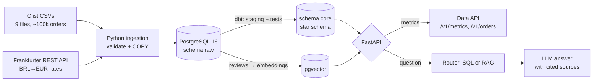
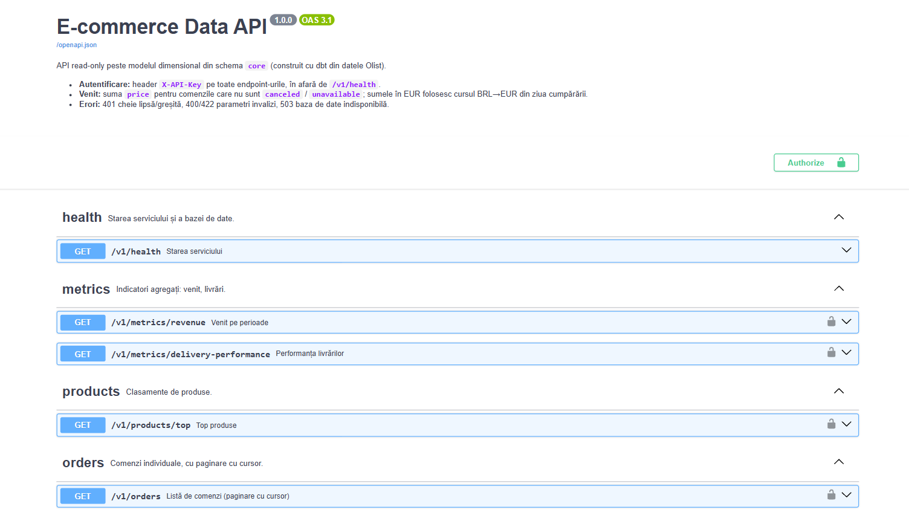
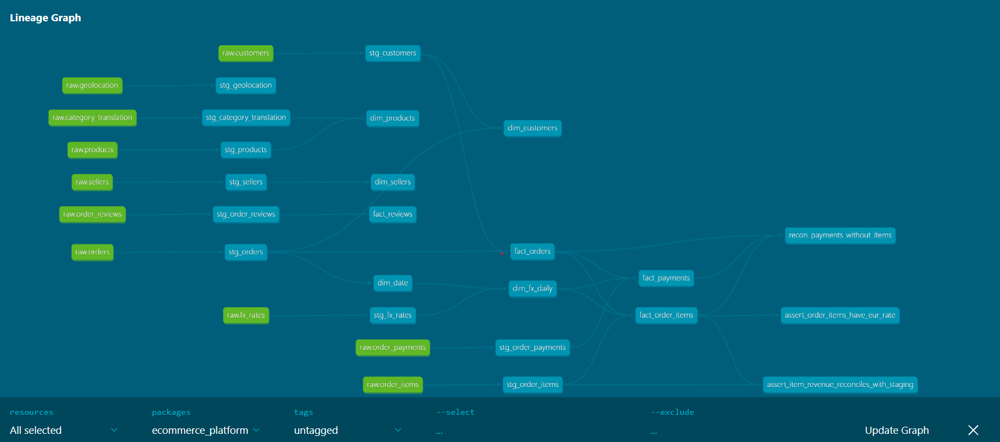

# E-commerce Analytics Assistant

> An end-to-end data platform that turns raw e-commerce data into a trustworthy analytical model, then lets people ask business questions in plain language. Answers come from SQL (numbers) or RAG over customer reviews (reasons), with sources cited.

**Status: work in progress.** Ingestion, the dbt models (staging + core star schema, with data tests), the read-only data API, review embeddings in pgvector and `/v1/ask` (a router that sends each question to restricted text-to-SQL or to RAG over reviews) are done and tested. Next: an evaluation set of test questions; see the [roadmap](#roadmap).

---

## Why this project

Most portfolio projects stop at "load a CSV and draw a chart". This one is built around the problems that make real data engineering hard:

- **Repeatable, verifiable loads**: running a pipeline twice must not duplicate data, and every load must prove it loaded what it expected.
- **Messy, realistic data**: the dataset has real quality issues (listed [below](#real-data-problems-this-project-tackles)) that a naive pipeline silently gets wrong.
- **Two kinds of questions**: "what was monthly revenue?" needs exact SQL, while "why are customers unhappy with delivery?" needs retrieval over text. The assistant routes between both and cites its evidence.

## Architecture



Built today: ingestion → `raw`, dbt → `core`, the FastAPI data API, review embeddings in pgvector, and the `/v1/ask` router with its two paths: read-only text-to-SQL and RAG answers over reviews.

## Tech stack

| Area | Technology |
|---|---|
| Languages | Python 3.12, SQL |
| Database | PostgreSQL 16 + pgvector, run in Docker |
| Ingestion | pandas, psycopg (`COPY`), `requests` with retry/backoff, run log (`etl_log`) |
| Transformation | dbt (staging + core models, data tests) |
| AI | multilingual embeddings, RAG, Gemini API, question router, read-only text-to-SQL validated with sqlglot |
| API | FastAPI, Pydantic, OpenAPI docs |
| Quality & delivery | pytest, GitHub Actions CI *(planned)*, Git/GitHub |

## What works today

### Batch ingestion of the Olist dataset
- Loads 9 CSV files into the `raw` schema with PostgreSQL `COPY`.
- **Repeatable**: a second run does not duplicate rows.
- **Verified**: row counts are compared against the source file after each load.
- **Logged**: every run is recorded in `raw.etl_log` (run id, source, rows expected vs loaded, status, error, timestamps).
- Handles a real-world quirk: a BOM in the category-translation file.

### REST API ingestion (Frankfurter exchange rates)
- Pulls daily BRL→EUR rates for the full order period, 2016-09-01 to 2018-11-12 (563 business days), from a public REST API.
- **Resilient**: timeouts, retry with exponential backoff on `429`/`5xx`, requests split into bounded date windows.
- **Raw first**: the unmodified JSON response is stored in `raw.fx_rates_raw` before any transformation, so loads can be audited and replayed.
- **Idempotent**: upsert on `(rate_date, base, quote)`; re-running it over the full period still yields exactly 563 rows.
- Unit-tested with pytest (date windowing, response flattening).

### Data API
A read-only FastAPI service over the `core` star schema. All endpoints are versioned under `/v1`:

| Endpoint | What it returns |
|---|---|
| `GET /v1/health` | Service status, including a database check (no API key needed; `503` if the database is down) |
| `GET /v1/metrics/revenue?from=&to=&granularity=day\|month\|year&currency=BRL\|EUR` | Revenue series and total, using the [revenue definition](#real-data-problems-this-project-tackles) (`is_revenue = true`) |
| `GET /v1/metrics/delivery-performance?state=SP` | Delivered orders, average delivery days, late orders and late percentage; `state` is optional |
| `GET /v1/products/top?category=&limit=10&metric=revenue\|quantity` | Top products by revenue or units sold (`limit` up to 100) |
| `GET /v1/orders?status=&limit=50&cursor=` | Orders, newest first, with cursor pagination (`limit` up to 200) |
| `POST /v1/ask` | Natural-language question, routed to read-only text-to-SQL (numbers) or to customer reviews (RAG, with cited sources). Body: `{"question", "top_k" (default 15, max 30), "min_score", "max_score"}` |

- **Authentication**: every endpoint except `/v1/health` requires an `X-API-Key` header. The key is compared in constant time, and a missing or wrong key returns `401`.
- **Least-privilege database access**: the API connects as `api_reader`, a login role created by `sql/init/04_api_role.sql`. It has `SELECT` on the `core` tables only, no access to `raw` or `staging`, and read-only sessions. Default privileges keep the grant in place when dbt rebuilds the tables. The password comes from an environment variable and is never stored in SQL.
- **Cursor pagination**: keyset pagination on `(order_purchase_at, order_id)`, not `OFFSET`. Each response includes an opaque `next_cursor`, which is `null` on the last page. Pages stay stable and never repeat rows.
- **Validation and errors**: query parameters are validated with Pydantic (for example `from <= to`, enums, limits, Brazilian state codes). Invalid input returns `422`, or `400` for a malformed cursor. Database failures return `503` with a generic message, and the internal details stay in the server log.
- **Docs**: interactive OpenAPI docs with descriptions and examples at [`/docs`](http://127.0.0.1:8000/docs) once the server is running.
- **Run it** (from the project root, with the variables from `.env`):
  ```bash
  dotenv -f .env run -- uvicorn app.main:app --reload
  ```
- **Known limitation**: the `state` filter in `/v1/metrics/delivery-performance` uses the customer's **current** address from `dim_customers`, which is the address on their most recent order. It does not use the address at the time of each order, so for customers who moved, an order can count toward their newer state.

#### `/v1/ask`: router
Each question is first classified by the LLM (short prompt, strict JSON, temperature 0) into one route, reported in the response's `route` field:

| Route | For | Answered by |
|---|---|---|
| `sql` | numbers, totals, rankings, rates over orders, revenue, delivery, products | read-only text-to-SQL over `core` (below) |
| `rag` | reasons, opinions, what customers say | semantic search over written reviews (below) |
| `unsupported` | anything outside this data (for example profit margins: there is no cost data) | a fixed "can't answer" message, no further LLM call |

If the LLM is unavailable or returns invalid JSON, a keyword classifier (English, Portuguese, Romanian) decides instead. When in doubt it picks `rag`, which is the pre-router behaviour. The notes say which method chose the route.

#### `/v1/ask` route `sql`: restricted text-to-SQL
- **What the LLM sees**: a compact description of the `core` tables only, generated from the dbt descriptions in `_core.yml` and the column types in `information_schema` (`raw`, `staging` and `core.review_embeddings` are left out), plus the metric definitions: revenue = `SUM(price_brl) WHERE is_revenue`, precomputed EUR columns, delivery = delivered orders with a delivery date. It must reply with one PostgreSQL `SELECT` (temperature 0), or `CANNOT_ANSWER: <reason>`.
- **Safety layers** before and during execution:
  1. **Validation with sqlglot**: no comments, exactly one statement, `SELECT` only (including `UNION` and read-only CTEs). It rejects `INSERT`/`UPDATE`/`DELETE`/`MERGE`, DDL, `COPY`, `SELECT INTO`, `FOR UPDATE`, data-modifying CTEs and unknown commands.
  2. **Allowlist**: only the documented `core` tables. Any reference to `raw`, `staging`, `pg_catalog`, `information_schema` or another database is rejected.
  3. **Function blocklist**: `pg_*` (including `pg_sleep`, `pg_read_file`), `lo_*`, `dblink*`, `set_config`/`current_setting`, `query_to_xml` and similar, sequences, `version()`, `current_user`.
  4. **What runs is what was checked**: the API executes the SQL sqlglot regenerates from the validated syntax tree, not the LLM's raw text.
  5. **Row cap**: the query is wrapped as `SELECT * FROM (...) LIMIT 200`.
  6. **Read-only role**: it runs only as `api_reader` (`SELECT` on `core` only), and the API checks the connected role before every query and refuses any other role or a superuser.
  7. **Read-only transaction with a 10 s `statement_timeout`.**
- **Repair**: if the query fails validation or execution, the error is sent back to the LLM once for a corrected query. If that also fails, the API returns `422` with a generic message; internal details stay in the server log.
- **Answer**: a second call writes a short answer in the question's language from the result rows only (at most 50 rows are shown to it). Response: `{"route": "sql", "answer", "sql" (the executed query), "rows" (up to 200), "row_count", "notes"}`.
- **Example** (real run): *"Which customer state has the highest percentage of late deliveries?"* produced `SELECT c.customer_state, ROUND(... 100.0 * COUNT(*) FILTER (WHERE o.is_late) / COUNT(*) ...) AS late_percentage FROM core.fact_orders AS o JOIN core.dim_customers AS c ... WHERE o.order_status = 'delivered' AND o.order_delivered_customer_at IS NOT NULL GROUP BY c.customer_state ORDER BY late_percentage DESC LIMIT 1`, returning `AL, 21.41`. That is the same value as `/v1/metrics/delivery-performance?state=AL`. In the same check, monthly revenue for 2017 matched `/v1/metrics/revenue` for all 12 months, and the top-5 categories and monthly delivery times matched independent SQL.
- **Known limits**:
  - The validator blocks unsafe SQL, not wrong SQL. A valid query can still answer a slightly different question (wrong filter, different month bucketing), so the executed `sql` is always returned for review.
  - Answers don't flag small samples (for example a month with a single delivered order).
  - Only the `core` schema can be asked about.
  - A `sql` question costs 3 LLM calls (route, query, answer) and a `rag` question 2, which counts against free-tier limits.
  - The keyword fallback is coarse.

#### `/v1/ask` route `rag`: questions over customer reviews
- **Retrieval**: the question is embedded with the same local model as the reviews (`intfloat/multilingual-e5-small`, loaded once at startup). It is matched by cosine similarity against the 40,641 embedded review texts in `core.review_embeddings`, queried as `api_reader`. Optional `min_score`/`max_score` filters apply. The API fetches 4× `top_k` candidates and drops near-identical texts (case, accent and punctuation-insensitive), so the sources are diverse.
- **Generation**: a Gemini model (`LLM_MODEL`, e.g. `gemini-3.5-flash-lite`) answers using only the retrieved reviews and cites them as `[n]`, matching the order of `sources`. It answers in the language of the question and says when the evidence is insufficient. Review texts are passed inside delimiters as untrusted data, and any instructions inside them are ignored.
- **Resilience**: retries on `429`/`503`/`504` (at most 2, exponential backoff, 30 s timeout), then one attempt with `LLM_FALLBACK_MODEL`. If both fail, the API returns `503` with a retry hint; a non-retryable LLM error returns `502`. When no review matches, it returns a "not enough evidence" answer without calling the LLM. The API key is never logged.
- **Response**: `answer`, `sources` (`review_id`, `review_score`, `text`, `similarity`), `retrieved_count`, and `notes` (subset caveat, model used, token usage). `route` is `"rag"`.
- **Limitation: the evidence skews negative.** Only reviews with a written comment can be retrieved: about 41% of all reviews. Unhappy customers write far more often, so 1-star reviews are 21% of written reviews vs 12% of all reviews. Answers describe what the retrieved reviews say, not how common an opinion is among all customers.
- **Privacy note**: on the free Gemini API tier, Google may use prompts and responses to improve its products. That is acceptable here because the Olist reviews are a public dataset. Do not send private or customer data through a free-tier key.

##### Example

```bash
curl -X POST http://127.0.0.1:8000/v1/ask \
  -H "X-API-Key: <your API_KEY>" \
  -H "Content-Type: application/json" \
  -d '{"question": "Why are customers unhappy with delivery?"}'
```

Response from a real run (trimmed):

```json
{
  "route": "rag",
  "answer": "Customers are unhappy with the delivery due to several key issues:\n\n* **Delays and missed deadlines:** Customers report significant delivery delays, failures to meet established deadlines, and long waiting times exceeding a month [4, 8, 10, 13].\n* **Non-delivery and cancellation issues:** Some customers did not receive their items at all, or had products marked as \"unavailable\" shortly before the delivery deadline, and even received items after explicitly asking to cancel [3, 5, 6].\n* **Problems with the carrier (Correios):** Complaints include the carrier failing to show up on the delivery date, recording false information (such as claiming nobody was at the location), failing to attempt delivery, and requiring customers to pick up items far from their homes [7, 11, 12].\n* **Lack of communication and customer support:** Customers complain about a lack of updates, notifications, explanations for delays, phone contact, or assistance from customer service and ombudsman channels [5, 8, 9, 10, 13, 14].\n* **High shipping costs:** High freight costs compared to the product's value also discourage purchases [1].\n\n*(Note: These are a subset of reviews: only reviews with written comments, which skew toward low scores.)*",
  "sources": [
    {
      "n": 4,
      "review_id": "b40a6984937cc251558d24d0b5caa929",
      "review_score": 1,
      "text": "Não cumprem os ´prazos e ignoram a expectativa do cliente. Falta profissionalismo. Impossível recomendar....."
    },
    {
      "n": 7,
      "review_id": "640a2362c470c6006b36ae2b39859859",
      "review_score": 3,
      "text": "INFELIZMENTE O ÚNICO PROBLEMA É A ENTREGA SER FEITA PELOS CORREIOS, NÃO COMPARECEM NA DATA DA ENTREGA E AINDA COLOCAM INFORMAÇÕES INCORRETAS! EX.: NÃO TINHA NINGUÉM NO LOCAL DE ENTREGA!"
    },
    {
      "n": 10,
      "review_id": "2d0a07007cc84621a2bc694505be4036",
      "review_score": 1,
      "text": "Atraso na entrega sem dar satisfação ao cliente, que com certeza escolheu o produto com cuidado e com as melhores expectativas. Falta de consideração."
    },
    {
      "n": 13,
      "review_id": "c04fd11d96ca96f3fda80b3d330f12de",
      "review_score": 1,
      "text": "Tem mais de um mês que comprei o produto e ainda não recebi. A gente paga na hora mas ninguém da nem satisfação quanto a entrega. Muita falta de respeito."
    }
  ],
  "retrieved_count": 60,
  "notes": [
    "Sources are written reviews only: about 41% of all reviews, skewed toward low scores (1-star reviews are 21% of written reviews vs 12% of all reviews).",
    "Retrieved 60 candidate reviews by semantic similarity; 15 kept after removing near-duplicate texts.",
    "Model: gemini-3.5-flash-lite",
    "Token usage: prompt=1138 output=276 thinking=0 total=1414"
  ]
}
```

*The `sources` list is shortened for readability: the real response has 15 sources, and the four shown here are numbers [4], [7], [10] and [13] in the answer's citations.*



*Auto-generated OpenAPI docs*

## Real data problems this project tackles

These issues are in the source data. Each one is handled in dbt and guarded by an automated test; the figures below come from the actual runs.



*dbt lineage graph: raw sources, staging models, star schema in core, and the reconciliation tests*

The graph reads left to right: the `raw` sources (green) feed the `stg_*` staging views, which build the dimensions and facts in `core` and end in the reconciliation model and tests, while the FX path (`raw.fx_rates` → `stg_fx_rates` → `dim_fx_daily`) feeds the EUR columns of `fact_order_items` and `fact_payments`.

| Problem | Why it matters | How it was handled |
|---|---|---|
| 789 `review_id`s repeated across 1,603 rows | Looks like duplicates; naive dedup would drop real data | Checked the data first: every repeat sits on a **different `order_id`** with identical content, and there are no exact duplicates. So nothing is deduplicated: `fact_reviews` uses the grain `(review_id, order_id)` with a `unique` test on that pair (99,224 rows). The staging `unique` test on `review_id` alone is kept as a `warn` to document the quirk. |
| 8 orders marked `delivered` with no delivery date | Breaks delivery-time metrics | Flagged with `has_delivery_date_issue` in `fact_orders`. For them `delivery_days` and `is_late` are `NULL`, so they fall out of delivery KPIs instead of skewing them. |
| 2 product categories without translation | Missing labels in reports | `dim_products.product_category` falls back to the Portuguese name (`pc_gamer`, 3 products; `portateis_cozinha_e_preparadores_de_alimentos`, 10 products) and sets `is_translation_missing`. A `not_null` test guards the column. |
| 610 products without a category | Silent gaps in category analysis | Mapped to an explicit `'unknown'` category with `is_category_missing = true`, never `NULL`. |
| Joining `order_items` with `order_payments` | **Duplicates revenue** (fan-out): the naive join yields 117,601 rows and R$ 14,209,115.34 in item price vs. the true R$ 13,591,643.70 (+4.5%) | Separate facts at their own grain: `fact_order_items` (order + item, 112,650 rows) and `fact_payments` (order + payment sequence, 103,886 rows). A singular test proves item price totals in the fact equal staging exactly. |
| FX rates exist only on business days | Weekend and holiday orders would have no rate | `dim_fx_daily` has one row per calendar day with an as-of rate (last ECB rate on or before that day): 239 of 800 days are filled (`is_filled`), the longest gap is 4 days. A test asserts every order item has an EUR rate. |
| Payments don't match items + freight | Payment totals would overstate revenue | Payments total R$ 16,008,872.12 vs. R$ 15,843,553.24 for items + freight (+R$ 165,318.88). Of that, R$ 162,591.95 comes from 775 orders that were paid but have no items (603 `unavailable`, 164 `canceled`, 5 `created`, 2 `invoiced`, 1 `shipped`). They are listed in `recon_payments_without_items`. Orders that have both items and payments differ by only R$ 2,870.39 in total (303 of 98,665 orders). No fact rows are deleted. |

**Revenue definition:** revenue = sum of `price` in `fact_order_items` for orders whose status is not `canceled` or `unavailable` (`where is_revenue`). Freight is excluded. This gives R$ 13,494,400.74 (≈ € 3,424,922.94 at the purchase-day rate).

## Roadmap

- [x] Dockerized PostgreSQL 16 + pgvector with `raw`, `staging`, `core` schemas
- [x] Repeatable CSV ingestion with row-count validation and run log
- [x] REST API ingestion (Frankfurter) with retry and idempotent load
- [x] dbt: staging models, star schema (`fact_order_items`, `fact_payments`, `fact_reviews`, dimensions, `dim_fx_daily`), data-quality tests
- [ ] Orchestration (Airflow or Dagster), optional
- [x] Review embeddings stored in pgvector
- [x] Data API (FastAPI): metrics, filters, cursor pagination, API-key auth, read-only DB role, pytest
- [x] `/v1/ask` RAG endpoint: semantic search over reviews, answers with cited reviews, retry + fallback model
- [x] `/v1/ask` question routing: RAG or read-only text-to-SQL (sqlglot validation, allowlist, read-only role, timeout, row cap)
- [ ] Evaluation on a set of 20–30 test questions
- [ ] CI (GitHub Actions), containerized app, architecture write-up

## Getting started

Requirements: Docker, Python 3.12.

```bash
# 1. Configure the environment (before the first `docker compose up`, which reads it)
cp .env.example .env
#    then replace every placeholder with your own values:
#    POSTGRES_PASSWORD, API_DB_PASSWORD and a long random API_KEY

# 2. Start PostgreSQL + pgvector
#    On a fresh volume this runs sql/init/ automatically: schemas, raw and FX tables,
#    and the read-only api_reader role (password taken from API_DB_PASSWORD).
docker compose up -d

# 3. Python environment
python -m venv .venv
source .venv/bin/activate        # Windows: .venv\Scripts\activate
pip install -r requirements.txt

# 4. Download the Olist dataset from Kaggle (link below) and place the CSVs in data/

# 5. Load the data (both scripts are safe to re-run)
python src/ingest/load_csv.py
python src/ingest/ingest_fx.py

# 6. Build and test the dbt models (dbt reads the connection from the .env variables)
cd dbt
dotenv -f ../.env run -- dbt run
dotenv -f ../.env run -- dbt test
cd ..

# 7. Existing database only: sql/init/ runs only on a new volume, so create
#    the api_reader role and the embeddings table once by hand (both safe to re-run)
dotenv -f .env run -- docker compose exec -T -e API_DB_PASSWORD db \
  sh -c 'psql -v ON_ERROR_STOP=1 -U "$POSTGRES_USER" -d "$POSTGRES_DB" -f /docker-entrypoint-initdb.d/04_api_role.sql'
docker compose exec -T db \
  sh -c 'psql -v ON_ERROR_STOP=1 -U "$POSTGRES_USER" -d "$POSTGRES_DB" -f /docker-entrypoint-initdb.d/05_pgvector.sql'

# 8. Embed the review texts (downloads the ~470 MB model once into .cache/; safe to re-run)
python src/rag/embed_reviews.py

# 9. Check the LLM key (LLM_PROVIDER, LLM_MODEL, LLM_API_KEY in .env): sends one tiny request
python src/rag/check_llm.py

# 10. Start the data API, then open http://127.0.0.1:8000/docs
#     Call protected endpoints with the header  X-API-Key: <your API_KEY>
dotenv -f .env run -- uvicorn app.main:app --reload

# 11. Run the tests (integration tests against the database are skipped
#     automatically when it is not reachable; the LLM is always mocked)
dotenv -f .env run -- pytest
```

Dataset: [Brazilian E-Commerce Public Dataset by Olist](https://www.kaggle.com/datasets/olistbr/brazilian-ecommerce) (~100k orders, 2016–2018). Raw data is not committed to this repository.

## Repository layout

```
sql/init/                     Database initialization, run on a fresh volume in order:
  01_init.sql                   pgvector extension + raw / staging / core schemas
  02_raw_tables.sql             raw tables for the Olist CSVs
  03_fx_tables.sql              raw.fx_rates_raw and raw.fx_rates
  04_api_role.sql               read-only api_reader role for the data API
  05_pgvector.sql               core.review_embeddings (vector(384)) + HNSW cosine index
src/ingest/                   Ingestion scripts (CSV loader, Frankfurter API, data inspection)
src/rag/                      Review embeddings and LLM tooling
  embed_reviews.py              embeds review texts into pgvector (repeatable, logged)
  search_reviews.py             command-line semantic search over reviews
  check_llm.py                  one-request check of the Gemini key and model
dbt/                          dbt project
  models/staging/               stg_* views over raw (renames, casts) + sources
  models/core/                  star schema: dim_*, fact_*, reconciliation model
  tests/                        singular tests + generic unique_combination_of_columns
  macros/                       generate_schema_name (exact schema names)
app/                          FastAPI data API
  main.py, config.py, db.py     app setup, settings, connection pool
  auth.py, schemas.py           X-API-Key auth, Pydantic models
  queries.py, pagination.py     parameterized SQL, keyset cursor
  embedder.py, llm.py, rag.py   question embedding, Gemini client (retry + fallback), RAG prompts
  routing.py                    question router (LLM + keyword fallback)
  text_to_sql.py, sql_guard.py  text-to-SQL prompts and read-only execution, SQL validator
  routers/                      health, metrics, products, orders, ask
tests/                        pytest tests (ingestion helpers)
  api/                          API tests (auth, validation, pagination, responses, /v1/ask, router,
                                text-to-SQL validator and execution, integration)
  rag/                          embedding script and LLM check tests
```

## Design decisions

- **Raw layer is append-faithful.** Data lands in `raw` exactly as received; all cleaning happens later in version-controlled, tested SQL. That keeps every transformation auditable and replayable.
- **Idempotency over cleverness.** Every load can be re-run safely, which makes failures cheap to recover from.
- **Text-to-SQL is restricted in layers.** Generated SQL is validated (SELECT only, table allowlist, function blocklist, row cap) and then runs through a read-only role limited to the `core` schema, in a read-only transaction with a timeout. A model mistake, or a prompt-injection attempt, cannot modify or leak other data even if one layer missed it.
- **Alternatives considered for serving data:** PostgREST/Hasura (auto-generated APIs) are useful in practice, but a hand-built FastAPI layer shows validation, pagination, versioning and auth explicitly.

## Author

Built by Necula Madalina Nicoleta · [LinkedIn](https://www.linkedin.com/in/m%C4%83d%C4%83lina-necula-5270b8305/) ·
